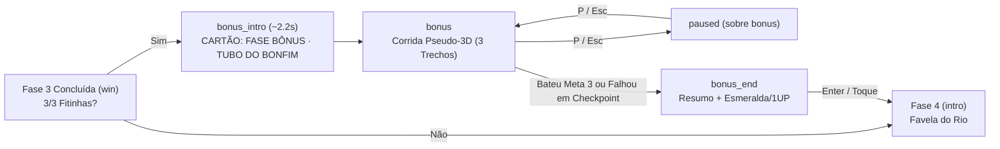

# Game Design Document (GDD): *Fase Bônus — Tubo do Bonfim (Special Stage Pseudo-3D)*

> **Documento Oficial de Design — Fase Bônus**  
> Referência de lore, desbloqueio, renderização pseudo-3D em meio-tubo (*half-pipe*), física, parceiro de equipe, estrutura dos 3 trechos, arte e áudio para a Fase Bônus de **"Pardo Kidd in Quixadá World"**, inspirada no *Special Stage* de *Sonic the Hedgehog 2* (Mega Drive).  
> Execução multiagente: [`../PLAN-BONUS.md`](../PLAN-BONUS.md) e [`plano_execucao_bonus.md`](plano_execucao_bonus.md).

---

## 1. Premissa & Desbloqueio ("O Vórtice das Fitinhas")

Ao final da **Fase 3 ("Bahia World", `levelIndex === 2`)**, durante o ritual no Santuário de Jandira, Pardo lambe o **Cajado Jailnesco**. Caso o jogador tenha encontrado e coletado **todas as 3 Fitinhas do Bonfim** (`state.ribbons >= state.ribbonsTotal && state.ribbonsTotal === 3`) espalhadas pelo Recife de Corais e pelas Ruínas Submersas, o brilho turquesa e dourado do cajado abre um **vórtice caleidoscópico** que suga o Pardo para uma dimensão onírica paralela: o **Tubo do Bonfim**.

Dentro desse túnel em meio-tubo que serpenteia pelo céu estrelado da Baía de Todos-os-Santos, **Pardo** dispara em alta velocidade (visto de costas) acompanhado de perto pelo seu parceiro **Caramelo-Tails** — um cãozinho vira-lata caramelo alado/de cauda dupla giratória que imita o trajeto do herói logo atrás, ajudando a coletar moedas!

### Regras de Acesso e Continuidade
1. **Condição de Desbloqueio:**
   * Na tela de vitória (`scene === 'win'`) da Fase 3 (`world.level.index === 2`), verifica-se `st.ribbons >= st.ribbonsTotal && st.ribbonsTotal > 0` (ou seja, `3/3` fitinhas).
   * **Se coletou 3/3 fitinhas:** o prompt piscante de conclusão muda para:  
     `"3/3 FITINHAS! ENTER OU TOQUE PARA A FASE BÔNUS"`  
     Ao confirmar, o jogo transita para a cena `'bonus_intro'` (em vez de pular direto para a Fase 4).
   * **Se coletou menos de 3 fitinhas (`0/3`, `1/3` ou `2/3`):** segue o fluxo normal para a **Fase 4 ("Favela do Rio")** com `"ENTER OU TOQUE PARA A FASE 4"`.
2. **Retorno para a Campanha:**
   * Ao concluir ou encerrar a Fase Bônus (seja vencendo todos os 3 checkpoints e pegando o Amuleto do Bonfim, seja falhando uma meta de moedas), exibe-se a tela de resumo `'bonus_end'`.
   * Ao confirmar na tela `'bonus_end'`, o jogo avança para a **Fase 4 ("Favela do Rio", `levelIndex = 3`)** (`loadLevel(3)` → `'intro'`), **preservando todas as moedas (`st.coins`), vidas (`st.lives`, incluindo eventual `1UP`) e pontuação (`st.score`)** conquistadas no bônus.
   * **Exceção do Modo Teste:** quando iniciado diretamente via atalho de URL (`?fase=bonus` ou `?bonus=1`), após `'bonus_end'` o jogador pode reiniciar o bônus ou seguir para a Fase 4 (`loadLevel(3)` — padrão: seguir para a Fase 4 se veio da campanha; no modo teste `?fase=bonus`, `ENTER` na `'bonus_end'` segue para a Fase 4 ou volta ao título/reinicia conforme especificado no fluxo unificado: seguir para `loadLevel(3)` mantém o fluxo 100% consistente e testável!).
3. **Zero Penalidade de Vidas:**
   * Não existe game over nem perda de vidas ou hidratação dentro da Fase Bônus. O pior resultado é sair mais cedo no checkpoint sem a recompensa máxima, levando consigo todos os pontos e moedas já coletados.

---

## 2. Fluxo de Cenas

1. **Cartão de Abertura (`Scene = 'bonus_intro'`):**
   * Fundo estrelado/caleidoscópico com o tubo ao longe por trás.
   * Cartão temático da Bahia: `"FASE BÔNUS"` + **`"TUBO DO BONFIM"`**, subtítulo `"COLETE MOEDAS E DESVIE DAS BOMBAS!"`, mostrando a meta inicial (`META 1: 20 MOEDAS`) e os sprites do Pardo e Caramelo-Tails de costas.
   * Dura `2.2s` (pulável após `0.25s` com `confirm` ou `start`), iniciando a música `'bonus'`.
2. **Corrida no Meio-Tubo (`Scene = 'bonus'`):**
   * HUD exclusiva de topo (`14px` de altura) exibindo:
     * Moedas do trecho/total na fase bônus (`bonusCoins / bonusTarget`), ícone `bonus_coin`.
     * Indicador do trecho atual (`TRECHO 1/3`, `2/3`, `3/3`).
     * Total acumulado de moedas normais (`st.coins`) e pontuação (`st.score`).
   * Pausa (`P` ou `Esc`) funciona normalmente como nas demais fases (`Scene = 'paused'`, guardando que a cena anterior era `'bonus'` para retornar corretamente a `'bonus'` ao despausar e reiniciar a música `'bonus'`).
3. **Tela de Resultado (`Scene = 'bonus_end'`):**
   * **Vitória Completa (3/3 trechos vencidos):** exibe o sprite animado `bonus_emerald` (2×), Pardo e Caramelo-Tails comemorando, total de moedas coletadas no tubo, bônus de **+5000 PONTOS** e **+1 VIDA (`1UP`)**, com o título `"AMULETO DO BONFIM!"` e `"ESPECIAL CONCLUÍDO!"`.
   * **Fim Parcial (falhou em um checkpoint):** exibe quantos trechos foram concluídos, total de moedas preservadas e mensagem `"FIM DO BÔNUS — MOEDAS MANTIDAS!"`.
   * Rodapé piscante: `"ENTER OU TOQUE PARA A FASE 4"`.

---

## 3. Direção Visual & Renderizador Pseudo-3D (`320×180`)

Todo o desenho respeita rigorosamente a resolução lógica `VIEW_W = 320`, `VIEW_H = 180` (rasterizado com `RENDER_SCALE = 2` no canvas, zero assets externos).

### 3.1. Geometria do Meio-Tubo (*Half-Pipe*)
* **Seção transversal:** semicírculo inferior parametrizado pelo ângulo $\theta \in [-\frac{\pi}{2}, +\frac{\pi}{2}]$, onde:
  * $\theta = 0$ é o fundo central do tubo;
  * $\theta = -\frac{\pi}{2}$ é a borda superior esquerda;
  * $\theta = +\frac{\pi}{2}$ é a borda superior direita.
* **Projeção em perspectiva ($z \in [z_{\min}, 1.0]$):**
  * $z = 1.0$ é o fundo distante (ponto de fuga / horizonte);
  * $z \approx 0.06$ é o plano próximo da câmera (logo atrás do Pardo);
  * Fator de escala em tela para cada profundidade $z$:  
    $$s(z) = \frac{d}{z + c}$$  
    (calibrado de modo que na frente ($z = 0.08$) o raio aparente do tubo seja $R_{\text{front}} \approx 148\text{ px}$ e no fundo ($z = 1.0$) seja $R_{\text{back}} \approx 14\text{ px}$).
* **Curvatura dinâmica da pista (estilo Sonic 2):**
  * A pista possui uma função contínua de curvatura horizontal (`curveX`) e vertical (`curveY`) por distância percorrida $s$.
  * Para cada anel de profundidade $z$, o centro do arco desloca-se proporcionalmente a $z^2$:
    * $\text{cx}(z) = 160 + \text{curveX} \cdot z^2 \cdot 68$
    * $\text{cy}(z) = 78 + \text{curveY} \cdot z^2 \cdot 28 + (1 - z) \cdot 18$
  * Isso faz o túnel dobrar organicamente para a esquerda, direita, subir e descer diante do jogador!
* **Projeção de um ponto $(\theta, z, h)$ no tubo:**
  * $h \ge 0$ é a altura radial acima da parede do tubo (para saltos do Pardo/parceiro ou moedas altas).
  * Raio efetivo em tela: $r = \max(2, R(z) - h \cdot s_{\text{h}}(z))$.
  * Coordenadas na tela `320×180`:
    * $x_{\text{scr}} = \text{cx}(z) + \sin(\theta) \cdot r$
    * $y_{\text{scr}} = \text{cy}(z) + \cos(\theta) \cdot r \cdot 0.64$ *(fator de achatamento vertical $0.64$ dá ótima leitura da profundidade na proporção 16:9 sem cortar o fundo do tubo)*.

### 3.2. Estética & Paleta do Túnel
* **Céu do Vórtice (camada de fundo):**
  * Fundo azul-profundo noturno (`#0d3b66` / `#16264f`) com gradiente sutil e estrelas pixeladas em paralaxe inversa às curvas do tubo (quando a pista vira à direita, as estrelas deslizam suavemente à esquerda).
* **Faixas do Tubo (paleta das Fitinhas do Bonfim):**
  * O tubo é desenhado em ~22 fatias (*slices*) de profundidade de trás para frente, divididas em **7 raias radiais** ($\theta$ particionado em 7 segmentos iguais de $-\frac{\pi}{2}$ a $+\frac{\pi}{2}$).
  * As cores alternam em padrão quadriculado longitudinal (*checkerboard* de velocidade) conforme a distância percorrida, usando cores da paleta oficial (`src/gfx/palette.ts`):
    * Raia externa / bordas: contorno escuro `#1a1423` + brilho `#7cf0e0` / `#ffffff`;
    * Padrão alternado das faixas: turquesa (`#2ec4b6` / `#1b9aaa`), amarelo-ouro (`#ffd23f` / `#d99a1c`), azul-marinho (`#3b6fd6` / `#24418f`) e coral-vermelho (`#ef476f` / `#e23b3b`), com listras laterais brancas (`#ffffff`) simulando o brilho especular do tubo!
  * Efeito de velocidade: linhas cinéticas claras nas bordas externas do túnel nos momentos de aceleração.

### 3.3. Escalonamento de Objetos e Sprites
* Todos os objetos na pista (moedas, bombas, portais de checkpoint e esmeralda) são ordenados por profundidade $z$ decrescente (*painter's algorithm*) e desenhados usando o `SpriteAtlas` com `ctx.save() / translate / scale / drawImage / restore`:
  * Uma sombra escura elíptica (`rgba(13,18,38,0.45)`) é projetada exatamente sobre a parede ($h = 0$) abaixo de itens elevados ou jogadores no ar, dando leitura espacial inequívoca da altura!
  * Para manter nitidez retro, o fator de escala de itens varia suavemente com $s(z)$ (de `0.25x` no horizonte até `1.25x` no primeiro plano), com fade-in suave nos últimos $10\%$ de distância ($z \in [0.90, 1.0]$) para nada "brotar" subitamente do nada.
* **Pardo e Parceiro de Costas:**
  * Pardo corre fixo no primeiro plano ($z_p = 0.085$).
  * **Caramelo-Tails** corre um pouco à frente na perspectiva ou levemente atrás? **No Sonic 2**, o Tails corre *ligeiramente à frente* ou *ligeiramente atrás* do Sonic; colocar o **Pardo em $z_p = 0.095$** e o **Parceiro em $z_b = 0.068$ (um pouquinho mais perto da câmera, ou $z_b = 0.125$ logo atrás/acima dependendo do ângulo)** — atenção: se o parceiro ficar em $z_b = 0.135$ (um pouco mais à frente dentro do tubo, como o Sonic na frente e Tails atrás, ou vice-versa):
    * **Decisão de design (legibilidade máxima):** O **Pardo** fica no plano principal de controle ($z_p = 0.085$, escala `1.0x`, totalmente visível em primeiro plano) e o **Caramelo-Tails** corre um pouco à frente na pista ($z_b = 0.145$, escala `0.86x`), **ou** logo ao lado/atrás com offset lateral leve quando ambos estão parados no centro ($\theta = 0$), evitando que o sprite do parceiro tampe o Pardo!
    * Colocar o **Caramelo-Tails em $z_b = 0.145$** (um passo à frente no túnel, ligeiramente menor em `0.85x`) é ideal: o jogador sempre vê o **Pardo inteiro** em primeiro plano para mirar nas moedas/bombas, e vê o parceiro correndo logo adiante no rastro (com `0.18s` de histórico de $\theta$ e pulo, ou seguindo suavemente para o lado de $\theta$ com atraso quando $\theta$ muda). *Nota: caso o parceiro siga um buffer de `0.18s` atrás em posição angular $\theta$, ficar um pouco mais fundo no tubo ($z_b = 0.145$, desenhado antes do Pardo) garante que o Pardo nunca seja ocluído pelo parceiro.*

---

## 4. Física, Controles e Mecânicas

### 4.1. Controles
Reutilizam integralmente o `Input` existente (`src/core/input.ts`) — **sem nenhuma tecla nova necessária**:
* **Mover pelas paredes do tubo:** `←` / `→` (`A`/`D` no teclado; `btn-left` / `btn-right` no touch).
* **Pular para o centro do tubo:** `↑` / `W` ou `Espaço` / `Z` / `J` (`input.pressed('jump') || input.pressed('punch')`; `btn-jump` / `btn-punch` no touch).
* **Pausar:** `P` ou `Esc` (`pause`).
* **Mutar áudio:** `M` ou `btn-mute` (`mute`).

### 4.2. Física Angular do Pardo
* **Ângulo na parede:** $\theta \in [-\theta_{\max}, +\theta_{\max}]$, com $\theta_{\max} = 1.48\text{ rad}$ ($\approx 85^\circ$, quase vertical nas bordas do meio-tubo).
* **Velocidade angular ($\omega$):**
  * Ao pressionar esquerda/direita, aplica-se aceleração angular $\alpha = 7.8\text{ rad/s}^2$ até $|\omega| \le 3.4\text{ rad/s}$.
  * **Gravidade tangencial:** o tubo "puxa" o personagem de volta para o fundo ($\theta = 0$) com aceleração $-g_\theta \cdot \sin(\theta)$, onde $g_\theta \approx 4.2\text{ rad/s}^2$, somada a um amortecimento suave ao soltar os controles. Assim, subir até as bordas exige segurar o direcional, e soltar devolve o Pardo naturalmente ao centro.
  * Nos limites $\pm \theta_{\max}$, $\theta$ é travado e $\omega$ zerado (o personagem corre na borda sem sair do tubo).
* **Salto radial ($h$):**
  * Quando no chão do tubo ($h = 0$), apertar pulo/soco dispara $v_h = +145\text{ px/s}$ com gravidade radial $g_h = 460\text{ px/s}^2$ (altura máxima $\approx 23\text{ px}$ em coordenadas lógicas de parede, duração $\approx 0.63\text{ s}$).
  * Enquanto no ar ($h > 0$), o controle lateral $\omega$ é reduzido em ~35%, mantendo a trajetória previsível.
* **Animação por inclinação:**
  * Além dos 4 frames de corrida (`pardo_bonus_run`), aplicamos pequena inclinação visual (`ctx.rotate(-theta * 0.45)`) sobre o pivô dos pés do Pardo (e do parceiro) para que eles acompanhem visualmente a curvatura da parede ao correr pelas laterais!

### 4.3. O Parceiro: Caramelo-Tails (`buddy_bonus_*`)
* **Identidade:** Uma versão estilizada e simpática do vira-lata caramelo do universo do jogo, com duas caudas giratórias que dão impulso no salto (homenagem direta ao Miles "Tails" Prower, sem copiar sprites ou propriedade intelectual).
* **Comportamento:**
  * Armazena um buffer circular de histórico das posições $(\theta, h)$ do Pardo nos últimos `11` passos (`~0.183 s` a `60 Hz`).
  * A posição do parceiro lê o registro de `11` frames atrás; quando ambos estão parados no mesmo ângulo, desloca-se sutilmente `+0.08 rad` para o lado para não sobrepor exatamente a silhueta.
  * **Coleta cooperativa:** o parceiro também coleta qualquer moeda (`bonus_coin`) dentro de sua janela de colisão ($\Delta z$ e $\Delta \theta$), somando diretamente no contador do bônus (`bonusCoins`), em `st.coins` e na pontuação (`+100` pts)!
  * **Generosidade com bombas:** se o parceiro encostar numa bomba (`bonus_bomb`), ele apenas pisca brevemente (`0.5s`, som discreto opcional ou visual), **sem fazer o jogador perder moedas**. Apenas colisões diretas com o Pardo descontam moedas.

### 4.4. Moedas, Bombas e Portais de Checkpoint
* **Moeda do Tubo (`bonus_coin`):**
  * Ao passar pela janela de profundidade do Pardo ($z \in [0.055, 0.115]$) ou do parceiro ($z \in [0.115, 0.175]$) com $|\Delta\theta| \le 0.22\text{ rad}$ e $|\Delta h| \le 18\text{ px}$:
  * Incrementa `bonusCoins += 1`, chama `world.addCoin()` (mantendo a regra oficial de `100` moedas = `+1 vida`!), adiciona `+100` pontos em `world.addScore(100)`, toca `'coin'` e solta partículas `'sparkle'`.
* **Bomba de Espinhos (`bonus_bomb`):**
  * Janela de colisão justa (levemente menor que o sprite visual para favorecer o jogador): $|\Delta\theta| \le 0.15\text{ rad}$, $|\Delta h| \le 11\text{ px}$, $z \in [0.065, 0.105]$.
  * Se `invuln <= 0`:
    * `invuln = 1.0` segundo (sprite `pardo_bonus_hurt` nos primeiros `0.35s`, depois piscando);
    * Perde `min(bonusCoins, 5)` moedas da meta da fase bônus (spawnando até 5 moedas visuais saltando para fora da tela, sem perder `st.score` já ganho nem vidas);
    * Toca `'bomb'` (e `'hurt'`), ativa `world.shake(4, 0.25)`.
* **Portal de Checkpoint (`bonus_gate`):**
  * Ao cruzar a distância de cada checkpoint (`t = 15s`, `30s`, `45s` ou distância equivalente em unidades de pista):
    * **Se `bonusCoins >= metaTrecho`:** toca `'checkpoint'`, `+1000` pontos, exibe banner flutuante `"META ATINGIDA!"` e avança para o trecho seguinte (velocidade do tubo sobe levemente: `1.0x → 1.15x → 1.30x`).
    * **Se `bonusCoins < metaTrecho`:** toca `'gameover'` (ou acorde curto de encerramento), exibe `"META NÃO ATINGIDA!"` e após `1.2s` vai para `'bonus_end'` com `cleared = false`.

---

## 5. Roteiro dos 3 Trechos (Padrões Determinísticos, Estilo Mega Drive)

Para garantir ritmo empolgante, aprendizado progressivo e validação matemática (`scripts/check-bonus.mjs`), o percurso do tubo é um roteiro determinístico de **ondas (waves)** espaçadas ao longo da distância total $D$:

| Trecho | Duração aprox. | Meta Acumulada | Mínimo de Moedas Disponíveis (≥ 140% da meta) | Padrões de Moedas & Bombas |
| :--- | :---: | :---: | :---: | :--- |
| **1 · Abertura Turquesa** | ~15 s | **20 moedas** | ≥ 32 moedas | Curva suave à direita e à esquerda; 3 fileiras centrais de moedas; arcos baixos nas paredes ($\pm 0.5\text{ rad}$); 2 linhas simples de 2 bombas fáceis de contornar; espiral aberta final. |
| **2 · Espiral do Bonfim** | ~16 s | **45 moedas** | ≥ 36 moedas novas (≥ 68 total) | Curvas em S alternadas + descida/subida suave; arcos de moedas altas ($h = 16\text{ px}$) que premiam o pulo sobre fileiras de bombas no fundo ($\theta = 0$); meias-luas de moedas alternando parede esquerda/direita. |
| **3 · Vórtice Estrelado** | ~17 s | **70 moedas** | ≥ 40 moedas novas (≥ 108 total) | Curvas rápidas alternadas; anéis de bombas com corredores livres claros de $\ge 0.45\text{ rad}$ (nunca bloqueia 100% da largura); zigue-zagues duplos de moedas para Pardo + Parceiro coletarem juntos; túnel espiral triunfal antes da **Esmeralda do Bonfim (`bonus_emerald`)**. |

> **Regra de ouro de design (anti-frustração):**  
> Nenhuma onda de bombas pode ocupar mais do que `60%` do arco disponível ao mesmo tempo sem uma janela de altura (`h > 14`) para pular por cima, garantindo que **todo obstáculo seja 100% evitável** tanto por desvio lateral quanto por salto.

---

## 6. Direção de Arte (`src/gfx/art/bonus.ts`)

Todos os sprites da Fase Bônus são autorados em **alta resolução 2×** (`RENDER_SCALE = 2`), contorno escuro `k` (`#1a1423`), usando apenas chaves da `PALETTE` oficial (`src/gfx/palette.ts`).

| Sprite | Spec `[w, h, frames]` | Descrição Visual (2×) |
| :--- | :---: | :--- |
| `pardo_bonus_run` | `[20, 24, 4]` | **Pardo visto de costas**: cabelo cacheado escuro (`h`, `H`, `x`), faixa lateral da armação dos óculos/máscara presa atrás da cabeça (`k`, `M`), camiseta amarela vibrante (`y`, `Y`) com movimento de ombros e braços, calça jeans azul (`b`, `B`) e tênis escuros com solado branco (`w`) alternando passadas em 4 quadros. |
| `pardo_bonus_jump` | `[20, 24, 2]` | **Pardo no ar (de costas)**: pernas dobradas / pose dinâmica de salto ou giro rápido em 2 quadros. |
| `pardo_bonus_hurt` | `[20, 24, 1]` | **Pardo atingido (de costas)**: braços abertos, corpo recuado em choque. |
| `buddy_bonus_run` | `[18, 22, 4]` | **Caramelo-Tails de costas**: cachorrinho vira-lata caramelo (`o`, `O`, `p`, `P`) correndo ereto em duas patas, orelhas caídas simpáticas e **duas caudas fofas girando/abanando** atrás em 4 quadros. |
| `buddy_bonus_jump` | `[18, 22, 2]` | **Caramelo-Tails pulando**: caudas girando como hélice acima/atrás do corpo. |
| `bonus_coin` | `[12, 12, 4]` | Moeda/argola dourada brilhante em 4 ângulos de rotação (`y`, `Y`, `f`, `a`, contorno `k`). |
| `bonus_bomb` | `[14, 14, 2]` | Mina estrelada com pontas metálicas (`K`, `q`, `Q`), centro vermelho pulsante (`r`, `R`, `m` entre frame 0 e 1). |
| `bonus_emerald` | `[16, 16, 2]` | **Amuleto / Esmeralda do Bonfim**: gema lapidada em turquesa brilhante e dourado (`8`, `&`, `9`, `y`, `w`) com brilho pulsante entre frames 0 e 1. |
| `bonus_gate` | `[16, 16, 2]` | Pilar/baliza luminosa de checkpoint com fitinha do Bonfim colorida tremulando (`c`, `y`, `r`, `w`). |

---

## 7. Direção de Áudio (`src/audio/audio.ts`)

### 7.1. Faixa Musical `'bonus'` (*"Axé Synthwave do Tubo"*)
* **Estilo:** Ritmo acelerado e energético de **136 BPM** (semicolcheia $\approx 0.110\text{ s}$), loop de **8 ou 16 compassos**, inspirado no clima arcade vibrante do Special Stage de Mega Drive fundido a um groove elétrico baiano.
* **Instrumentação (Web Audio API puro):**
  * **Lead:** onda quadrada/pulso 25% brilhante em arpejos rápidos e melodia marcante em **Dó# Menor / Lá Mixolídio** ou **Mi Menor**.
  * **Baixo (FM-like):** onda dente-de-serra/triângulo com oitavas pulsantes em colcheias/semicolcheias (*driving bassline*).
  * **Percussão:** bumbo sintetizado firme nos 4 tempos + chimbal/agogô metálico em semicolcheias no contratempo.

### 7.2. Novos Efeitos Sonoros (`SfxName`)
* `'bomb'`: explosão seca 8-bit com ruído branco filtrado em varredura descendente + tom grave caindo rápido (`160Hz → 45Hz`, `~0.28s`).
* `'emerald'`: fanfarra curta cintilante em arpejo ascendente rápido (`C5-E5-G5-B5-C6-E6-G6`, onda pulso + triângulo, `~0.75s`) ao capturar a Esmeralda do Bonfim.

---

## 8. Fora de Escopo
* Modo multiplayer local para 2 jogadores controlando o parceiro independentemente (o parceiro é 100% autônomo via histórico do jogador).
* Mais de uma Fase Bônus (ex.: após Fase 4 ou 5) — este escopo cobre exclusivamente a Fase Bônus após a **Fase 3 ("Bahia World")** ao coletar **3/3 Fitinhas do Bonfim**.
* Texturas mapeadas por pixel com matrizes 3D ou WebGL (tudo deve usar **Canvas 2D puro** dentro do pipeline existente).
