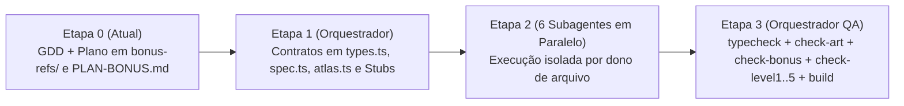

# Plano de Execução Multi-Agente — Fase Bônus ("Tubo do Bonfim")

> **Documento de Orquestração e Alocação de Modelos**  
> Define a arquitetura em etapas, os contratos compartilhados, o isolamento estrito de arquivos por agente e os critérios de validação para implementar a Fase Bônus pseudo-3D após a Fase 3.

---

## 1. Arquitetura de Orquestração ("Contratos Primeiro")

Seguindo o padrão comprovado nas Fases 1 a 5 (`PLAN.md` a `PLAN-FASE6.md`), a implementação é executada de forma autônoma em **3 etapas**:



### Etapa 1 — Preparação dos Contratos pelo Orquestrador (Antes de paralelizar)
O Orquestrador edita exclusivamente os arquivos de contrato e registra os stubs para garantir que `npm run typecheck` passe antes de disparar os subagentes:

1. **`src/core/types.ts`**:
   * Expandir `Scene` para incluir: `'bonus_intro' | 'bonus' | 'bonus_end'`.
   * Expandir `MusicTrack` para incluir `'bonus'`: `export type MusicTrack = LevelTheme | 'bonus';`.
   * Expandir `SfxName` para incluir `'bomb' | 'emerald'`.
   * Adicionar a interface `BonusState` e o campo `bonus: BonusState` em `GameState` (ou inicializar em `GameWorld`):
     ```ts
     export interface BonusState {
       /** true quando o fluxo atual veio da campanha/atalho para a Fase Bônus */
       active: boolean;
       /** moedas coletadas dentro da Fase Bônus */
       coins: number;
       /** meta atual de moedas do trecho (20 → 45 → 70) */
       target: number;
       /** trecho atual (1..3) */
       stage: 1 | 2 | 3;
       /** true se concluiu todos os 3 trechos e ganhou a Esmeralda do Bonfim */
       cleared: boolean;
       /** motivo do término parcial ou completo */
       endedByCheckpoint: boolean;
     }
     ```
2. **`src/gfx/spec.ts`**:
   * Adicionar a seção `FASE BÔNUS — TUBO DO BONFIM (PSEUDO-3D)` com os 9 sprites em 2×:
     * `pardo_bonus_run: [20, 24, 4]`
     * `pardo_bonus_jump: [20, 24, 2]`
     * `pardo_bonus_hurt: [20, 24, 1]`
     * `buddy_bonus_run: [18, 22, 4]`
     * `buddy_bonus_jump: [18, 22, 2]`
     * `bonus_coin: [12, 12, 4]`
     * `bonus_bomb: [14, 14, 2]`
     * `bonus_emerald: [16, 16, 2]`
     * `bonus_gate: [16, 16, 2]`
3. **`src/gfx/atlas.ts` e `scripts/check-art.mjs`**:
   * Importar `BONUS_ART` de `./art/bonus` (ou `../src/gfx/art/bonus.ts`) e incluí-lo no spread `{ ..., ...BONUS_ART }`.
4. **Stubs compiláveis**:
   * `src/gfx/art/bonus.ts` exportando `BONUS_ART: SpriteArt = {}` inicialmente vazio (ou com placeholders mínimos).
   * `src/game/bonus.ts` exportando o contrato tipado `BonusStage`, `createBonusStage(): BonusStage`, e os dados/constantes exportadas da pista para permitir validação por `scripts/check-bonus.mjs`.

---

## 2. Alocação de Módulos e Isolamento de Arquivos

Cada agente da **Etapa 2** possui propriedade exclusiva sobre seus arquivos (zero conflito de escrita concorrente):

| Módulo | Arquivos Exclusivos | Complexidade / Perfil | Responsabilidade Técnica |
| :--- | :--- | :--- | :--- |
| **`ART-BONUS`** | `src/gfx/art/bonus.ts` | Média-Alta (Pixel Art 2×) | Desenhar em grade 2× os 9 sprites (`23` frames no total): Pardo de costas correndo/pulando/ferido, Caramelo-Tails de costas com 2 caudas, moeda 4 frames, bomba estrelada 2 frames, esmeralda do Bonfim 2 frames e baliza de checkpoint 2 frames. Validar com `check-art.mjs` e inspecionar PNG de preview. |
| **`BONUS-ENGINE`** | `src/game/bonus.ts`, `scripts/check-bonus.mjs` | Alta (Matemática 3D + Simulação) | Implementar `createBonusStage()`: renderizador pseudo-3D Canvas 2D do meio-tubo com curvas dinâmicas e anéis coloridos das fitinhas; física angular $\theta$ + salto radial $h$; histórico de atraso `0.18s` do parceiro; roteiro determinístico de ondas dos 3 trechos (`20 / 45 / 70` moedas); partículas de moedas perdidas e fogos/brilhos da esmeralda. Criar `scripts/check-bonus.mjs` testando estrutura das ondas, densidade de moedas (≥ 135% da meta por trecho), impossibilidade de bloqueio total de bombas e simulação de bot vencendo os 3 checkpoints. |
| **`CORE`** | `src/game/game.ts`, `src/main.ts` | Alta (Máquina de Cenas) | Integrar `bonus_intro`, `bonus`, `bonus_end` no `GameWorld.step()`, `GameWorld.render()` e `onHidden()` (`paused` deve lembrar se pausou de `'playing'` ou `'bonus'`). Implementar detecção na conclusão da Fase 3 (`st.levelIndex === 2 && st.ribbons >= st.ribbonsTotal && st.ribbonsTotal > 0`) → `startBonus()`. Ao finalizar `'bonus_end'`, carregar Fase 4 (`loadLevel(3)` → `'intro'`). Suportar `?fase=bonus` e `?bonus=1` em `main.ts` / `GameOptions`. |
| **`HUD`** | `src/game/hud.ts` | Média (UI Canvas) | Atualizar `drawTitle` (aviso de modo teste `?fase=bonus`), `drawWin` (para `idx === 2` quando `st.ribbons >= st.ribbonsTotal && st.ribbonsTotal > 0`, trocar prompt para `"3/3 FITINHAS! ENTER OU TOQUE PARA A FASE BÔNUS"`), e adicionar `drawBonusIntro`, `drawBonusHud` e `drawBonusEnd`. Garantir uso exclusivo de caracteres presentes em `src/gfx/font.ts`. |
| **`AUDIO`** | `src/audio/audio.ts` | Média (Síntese Web Audio) | Adicionar a faixa `'bonus'` (136 BPM, groove elétrico/synthwave baiano estilo Special Stage em loop) no sequenciador e adicionar os SFX `'bomb'` e `'emerald'` mantendo inalteradas as faixas `'sertao'`, `'amazonia'`, `'bahia'`, `'rio'` e `'sampa'`. |
| **`DOCS`** | `README.md`, `lore.md`, `AGENTS.md`, `.gitignore` | Baixa | Documentar a Fase Bônus, condição das 3 fitinhas na Fase 3, controles no meio-tubo, atalho `?fase=bonus` e `node scripts/check-bonus.mjs` nos docs; ignorar `bonus-refs/` no `.gitignore` se desejado ou documentar junto às referências. |

---

## 3. Contratos de Integração entre Módulos

### 3.1. `BONUS-ENGINE` (`src/game/bonus.ts`) ↔ `CORE` (`src/game/game.ts`)
```ts
export interface BonusStage {
  /** reinicia a corrida bônus no trecho 1 (zera moedas do bônus, posiciona no centro) */
  reset(world: World): void;
  /**
   * Simula 1 passo fixo (dt = 1/60s).
   * Retorna:
   *  - 'running' enquanto o tubo está ativo;
   *  - 'cleared' quando venceu os 3 trechos e pegou a Esmeralda do Bonfim;
   *  - 'failed' quando cruzou um checkpoint abaixo da meta.
   */
  update(dt: number, world: World, input: Input): 'running' | 'cleared' | 'failed';
  /** Desenha céu estrelado, meio-tubo pseudo-3D, sombras, itens, parceiro e Pardo. */
  render(ctx: CanvasRenderingContext2D, world: World): void;
}
```
* **Acoplamento limpo:** `GameWorld` delega integralmente `update()` e `render()` para `BonusStage` nas cenas `'bonus_intro'` (renderiza apenas fundo + tubo parado ao fundo, depois `drawBonusIntro`) e `'bonus'` (simula `update`, desenha `render`, depois `drawBonusHud`).
* **Uso de `World` dentro de `BonusStage`:**
  * Ao pegar moeda: `world.state.bonus.coins += 1; world.addCoin(); world.addScore(100); world.audio.play('coin');`
  * Ao bater em bomba: reduz `world.state.bonus.coins` (mínimo 0), `world.audio.play('bomb')`, `world.shake(4, 0.25)`.
  * Ao passar checkpoint com meta batida: `world.state.bonus.stage` avança (`1→2→3`), `world.state.bonus.target` atualiza (`20→45→70`), `world.addScore(1000)`, `world.audio.play('checkpoint')`.
  * Ao vencer o trecho 3 (`'cleared'`): `world.state.bonus.cleared = true`, `world.addScore(5000)`, `world.state.lives = Math.min(EASY_LIVES, world.state.lives + 1)`, `world.audio.play('emerald')` + `world.audio.play('oneup')`.

### 3.2. `CORE` (`src/game/game.ts`) ↔ `HUD` (`src/game/hud.ts`)
* Em `GameWorld`:
  * Novo campo privado `pausedFrom: 'playing' | 'bonus' = 'playing'` para que pausar durante `'bonus'` retorne exatamente para `'bonus'` e retome `audio.startMusic('bonus')`.
  * Em `win` (cena `'win'`):
    ```ts
    const unlockBonus =
      st.levelIndex === 2 &&
      st.ribbonsTotal > 0 &&
      st.ribbons >= st.ribbonsTotal;
    if (unlockBonus) {
      this.startBonus();
    } else if (st.levelIndex + 1 < LEVEL_COUNT) {
      this.nextLevel();
    } else {
      this.newGame(0);
    }
    ```
  * Em `main.ts`:
    * `startModeFromUrl()` lê `?fase=bonus` ou `?bonus=1`, passando `{ startBonus: true }` em `GameOptions`. Quando `startBonus` é `true`, iniciar no título (ou clicar/Enter) dispara `world.startBonus()` direto em vez de `newGame(0)`.
* Em `hud.ts`:
  * Exportar `drawBonusIntro(ctx, world)`, `drawBonusHud(ctx, world)` e `drawBonusEnd(ctx, world)`.
  * Garantir que **nenhuma string** contenha glifos fora de `src/gfx/font.ts` (sem `%`, `=`, `$`, `;`).

---

## 4. Bateria de Validação Final (Etapa 3 — Orquestrador)

Após concluir todos os módulos da Etapa 2, o Orquestrador executa e verifica:
1. `npm run typecheck` → **0 erros**.
2. `node scripts/check-art.mjs art-preview-bonus.png pardo_bonus,buddy_bonus,bonus_` → **"arte OK"**, sem ausentes, seguido de inspeção visual da imagem gerada.
3. `node scripts/check-bonus.mjs` → **100% aprovado** (metas atingíveis com folga ≥ 135%, sem bloqueios impossíveis, bot alcançando a Esmeralda).
4. `node scripts/check-level.mjs && node scripts/check-level2.mjs && node scripts/check-level3.mjs && node scripts/check-level4.mjs && node scripts/check-level6.mjs` → **todas as 5 fases intactas**.
5. `npm run build` → **build limpo em `dist/`**.
6. Teste funcional no navegador (ou simulação via script/headless se aplicável) cobrindo:
   * `?fase=bonus`: título → `bonus_intro` → `bonus` (teclado + touch) → pausa (`P`/`Esc`) → `bonus_end` → `FASE 4`.
   * `?fase=3`: completar Fase 3 com `< 3` fitinhas vai para Fase 4; completar com `3/3` fitinhas oferece e entra na Fase Bônus.
